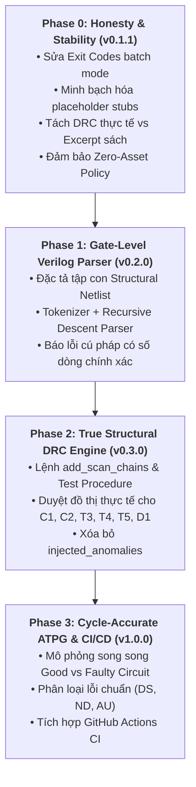

# Kế hoạch hoàn thiện Tessent Shell Simulation Lab

## Mục tiêu và phạm vi

Xây dựng một lab học tập chạy trực tiếp trên máy, mô phỏng **một tập con được công bố rõ** của Tessent Shell 2026.2. Mỗi lệnh và quy tắc trong tập con phải có hành vi xác định, kiểm thử độc lập và ghi nguồn trong hai manual. Không tuyên bố tương đương toàn bộ Tessent, không dùng kết quả lab để sign-off thiết kế. Full Tcl, thư viện cell thương mại, định dạng TSDB/STIL hoàn chỉnh và các công nghệ ATPG nâng cao nằm ngoài phạm vi ban đầu.

**Tài liệu đối chiếu:** `tshell_ref.pdf` (Reference Manual 2026.2 Rev 43), `tshell_user.pdf` (User's Manual 2026.2 Rev 42). Số trang bên dưới là số trang PDF, không nhất thiết là số trang in trên sách.

## 0. Loại bỏ kết quả gây hiểu nhầm và ổn định môi trường

- [ ] Trong `tshell.py` và `tessent_core/state.py`, trả lỗi rõ cho lệnh chưa thực sự được triển khai; `create_patterns` và `write_tsdb_data` không được tuyên bố tạo pattern hoặc TSDB thật khi chỉ có placeholder.
- [ ] Batch `-c`/`-f` phải trả mã lỗi khác 0 và dừng khi gặp lệnh không hợp lệ, file không tồn tại hoặc lỗi thực thi; kiểm thử từng trường hợp và trường hợp thành công.
- [ ] Tách phần **trích dẫn ví dụ từ PDF** khỏi báo cáo DRC của thiết kế hiện tại; không hiển thị transcript sách như vi phạm được phát hiện trên mạch.
- [ ] Trong `tessent_core/state.py`, `tessent_core/drc.py`, `exercises.py`, hỗ trợ PDF bên ngoài qua đường dẫn cấu hình rõ ràng; PDF chỉ là tài nguyên tùy chọn, không phân phối trong repo. Test core chạy không cần PDF; test tích hợp với bản PDF hợp lệ chạy riêng khi có tài liệu, và báo skip rõ ràng khi thiếu.
- [ ] Cập nhật README: báo đúng số lượng mục catalog, nêu rõ chức năng thực tế, giới hạn coverage và Icarus là tùy chọn cho RTL; cài lại trên venv sạch, kiểm tra các CLI và `pip check`.

**Hoàn thành khi:** không còn kết quả thành công giả; lỗi batch có mã thoát đúng; project chạy độc lập với thư mục cha. Những quy tắc chưa triển khai trả trạng thái chưa hỗ trợ, không được báo là đã kiểm tra và sạch.

## 1. Định nghĩa và đọc tập con Verilog

- [ ] Đặc tả trong README hoặc tài liệu riêng các cấu trúc hỗ trợ: port, wire, primitive cơ bản, biểu thức, DFF, reset, clock và scan mux; ghi rõ các cấu trúc chưa hỗ trợ.
- [ ] Thay parser regex trong `tessent_core/netlist.py` bằng parser kiểm tra cú pháp hoặc frontend có khả năng xử lý tập con đã chọn. Không tự tạo scan chain dựa vào thứ tự `reg`; cấu trúc không hỗ trợ phải báo lỗi có vị trí thay vì bỏ qua.
- [ ] Thêm fixture độc lập cho AND instance (đủ bốn tổ hợp), biểu thức có ngoặc/lồng nhau, mạch hai DFF với shift và capture, cùng ví dụ cú pháp không hỗ trợ.
- [ ] Định nghĩa cell mẫu, chân, cực tính, reset, ánh xạ bus và cách xử lý cell/hierarchy chưa hỗ trợ. Chọn một hướng nhất quán: hỗ trợ mẫu `always @(posedge clk)` giới hạn mà `insertion.py` đang sinh, hoặc đổi đầu ra insertion sang cell structural có model tương ứng. Test tích hợp từ insertion → parser → simulation và đối chiếu Icarus.

**Hoàn thành khi:** graph phản ánh đúng connectivity của fixture; fixture không hỗ trợ bị từ chối; không có gate hoặc port âm thầm biến mất.

## 2. Mô phỏng logic và scan theo thời gian

- [ ] Sửa `logic4.py` và `netlist.py` để hỗ trợ hành vi 0/1/X/Z, fanout, cạnh clock, reset, cập nhật DFF đồng thời và các bước shift/capture đúng theo tập con công bố.
- [ ] Dùng testbench trong `rtl/` làm đối chứng độc lập với Icarus chạy native. Đối chiếu từng chu kỳ của mạch hai DFF, gồm reset, shift, capture, X/Z và sự kiện không có cạnh clock.

**Hoàn thành khi:** kết quả từng chu kỳ của simulator khớp testbench Icarus trên toàn bộ fixture hỗ trợ; trường hợp chưa mô phỏng được phải báo rõ.

## 3. Fault simulation và coverage

- [ ] Trong `tessent_core/atpg.py`, chạy mạch chuẩn và mạch có fault từ cùng trạng thái đầu cho từng pattern; chỉ đánh dấu detected khi kết quả quan sát xác định và khác nhau. Định nghĩa hành vi với X/Z và vị trí tiêm fault.
- [ ] Thêm test cho net không nối, fault bị che, fault quan sát được, SA0/SA1, scan unload, và vét cạn input của mạch nhỏ; kiểm tra cả tử số và mẫu số coverage.
- [ ] Chỉ phân loại và tính các loại fault thực sự được hỗ trợ; không tự coi fault chưa phát hiện là untestable. `create_patterns` chỉ được công bố là hoạt động khi thực sự tạo và lưu pattern.
- [ ] Phân biệt fault grading của pattern đã có với ATPG tạo pattern; không gọi phần đầu là ATPG hoàn chỉnh. Công bố định nghĩa tử số/mẫu số và các loại fault hỗ trợ: `DS / total` chỉ là tỷ lệ riêng của DS trên tập fault được mô hình hóa, không mặc định là công thức tổng quát cho mọi phân loại của Tessent.

**Hoàn thành khi:** net không nối và fault bị che không bị tính detected; kết quả good/faulty và coverage khớp oracle độc lập trên mạch nhỏ.

## 4. DRC thực sự theo rule được hỗ trợ

- [ ] Xây dựng biểu diễn scan chain, test procedure và timeplate cần cho các kiểm tra; không dùng `injected_anomalies` làm bằng chứng phát hiện trên thiết kế.
- [ ] Thực hiện lần lượt C1/C2, T3, T4/T5, D1 theo phạm vi đã đặc tả, đối chiếu Reference Manual trang PDF 3809–3814, 3863–3866, 4522–4531 và User's Manual trang 923, 927, 955.
- [ ] Với mỗi rule, thêm một fixture hợp lệ, một fixture vi phạm có nguyên nhân rõ và test thiếu thông tin procedure; quy tắc chưa đủ dữ liệu phải báo chưa kiểm tra.
- [ ] Chuẩn hóa trạng thái từng rule: `NOT_RUN`, `PASSED`, `VIOLATION`, `INCOMPLETE_DATA`, `UNSUPPORTED`. Kết quả tổng không được coi là sạch nếu rule bắt buộc chưa chạy, thiếu dữ liệu hoặc không hỗ trợ. Mô hình `ScanChain` và `TestProcedure` có giao diện rõ, không bắt buộc nhúng vào `CircuitGraph`.
- [ ] Thực hiện simulator theo chu kỳ và model procedure trước DRC phụ thuộc thời gian. C1 xét trạng thái pin theo từng cell và cực tính, gồm set/reset; C2 xét các đường liên quan đến clock, set/reset và enable theo phạm vi hỗ trợ. T4 yêu cầu active event trong shift; T5 xét X trên clock và X/active trên set/reset; D1 xét disturbance qua các thời điểm procedure. Thiếu ngữ nghĩa hoặc dữ liệu thì báo chưa hỗ trợ/chưa đủ, không suy luận chỉ từ kết nối tĩnh.

**Hoàn thành khi:** DRC báo đúng vị trí/nguyên nhân ở fixture vi phạm, không báo vi phạm ở fixture hợp lệ, và phân biệt được sạch với chưa được kiểm tra.

## 5. Tương thích lệnh và workflow

- [ ] Lập bảng lệnh: cú pháp manual, context/mode hợp lệ, trạng thái hỗ trợ và sai khác có chủ ý. Ưu tiên `set_context`, `set_system_mode`, `read_verilog`, `add_clocks`, `check_design_rules`, `report_drc_rules`, `add_faults`, `simulate_patterns`.
- [ ] Sửa `add_clocks` theo Reference Manual trang PDF 131; kiểm thử `add_clocks 0 clk`, tham số sai và clock không tồn tại. Đối chiếu các mode trong User's Manual trang 35–39.
- [ ] Quy định nguồn pattern cho `simulate_patterns` theo Reference Manual trang 3510, từ chối tùy chọn chưa hỗ trợ. Không giả lập workflow đầy đủ của User's Manual trang 248 khi thiếu cell library hoặc bước bắt buộc.
- [ ] Giữ `report_drc_rules` dành cho kết quả DRC thực tế theo phần hỗ trợ của manual; chuyển tra cứu/trích dẫn tài liệu sang lệnh riêng có tên phân biệt. Xác minh cú pháp từng lệnh, bao gồm scan chain và pin constraints, trước khi công bố tương thích.
- [ ] Mỗi lệnh được đánh dấu hỗ trợ phải có test thành công, lỗi cú pháp, sai mode và batch exit status. Những lệnh còn lại trả lỗi chưa hỗ trợ.

**Hoàn thành khi:** bảng khả năng và hành vi thực tế khớp nhau; ví dụ từ manual trong phạm vi hỗ trợ chạy đúng hoặc báo rõ lý do chưa hỗ trợ.

## 6. Kiểm thử phát hành và bảo trì

- [ ] Thiết lập CI ngay từ giai đoạn 0 cho bộ core không PDF; chạy RTL native với Icarus ở job riêng và kiểm tra thông báo thiếu công cụ. Xác minh phiên bản Python, hệ điều hành và dependency thực tế trước khi công bố matrix; bổ sung test PDF tùy chọn ngoài CI công khai khi có tài liệu hợp lệ.
- [ ] Đối chiếu fixture với expected độc lập và Icarus; test trích transcript PDF chỉ chứng minh đọc tài liệu, không chứng minh DRC/ATPG đúng.
- [ ] Ghi lại phiên bản, lệnh tái hiện, kết quả và các giới hạn còn lại; rà lại README sau mỗi giai đoạn.

**Điều kiện hoàn tất roadmap:** toàn bộ tiêu chí của từng giai đoạn đạt; bộ core và RTL chạy đầy đủ trong môi trường có Icarus, còn test PDF tùy chọn chạy riêng trong môi trường có tài liệu hợp lệ. Mọi khác biệt chưa thực hiện đều được ghi rõ. Tính tương đương với sản phẩm Tessent thương mại không thuộc tiêu chí hoàn tất.

## Điều chỉnh sau review Antigravity

Phụ lục bên dưới được giữ nguyên làm lịch sử review. Khi có khác biệt, **các mục 0–6 và phần điều chỉnh này là kế hoạch ưu tiên**, không lấy ví dụ hoặc ước lượng trong phụ lục làm đặc tả thực thi.

- **Đồng ý:** chia milestone, PDF tùy chọn theo Zero-Asset Policy, thêm trạng thái DRC, model scan/procedure và CI. Trong `.gitignore` hiện có `*.pdf`, và không có PDF được Git theo dõi; điều này không tự xác nhận mọi khẳng định pháp lý hoặc nguồn gốc dữ liệu khác.
- **Thứ tự triển khai:** P0 minh bạch + CI cơ bản → parser và model cell → logic/scan theo thời gian → DRC theo rule và fault grading → pattern generation nếu nằm trong phạm vi đã đặc tả. DRC theo procedure không thể hoàn thiện chỉ bằng graph traversal trước simulator theo thời gian.
- **Cú pháp và semantics:** ví dụ `add_clocks clk -off_state 0` ở phụ lục không khớp manual trang 131; ví dụ phù hợp là `add_clocks 0 clk`. Cú pháp `add_scan_chains chain1 -scan_in ...` trong phụ lục cũng không khớp: manual trang 374 yêu cầu group đã khai báo, ví dụ `add_scan_chains chain1 grp1 si1 so1`. `report_drc_rules` không nên được đổi thành lệnh chỉ tra cứu sách. C1/C2, T4/T5 và D1 cần xử lý theo model pin, cực tính và thời gian đã nêu ở mục 4, không áp dụng nguyên xi các giả định trong phụ lục.
- **Không khóa trước cách viết parser:** parser thuần Python là một lựa chọn, không phải yêu cầu; chọn frontend sau khi thử nghiệm khả năng, giấy phép, tính di động và test. Tập con chỉ structural như phụ lục chưa đọc được output behavioral của `insertion.py`; phải giải quyết bài toán tích hợp ở mục 1.
- **Không coi warning là thành công:** lệnh placeholder phải báo chưa hỗ trợ và batch trả nonzero. `DS / total` và các nhãn fault chỉ được công bố theo phân loại được triển khai; fault grading và ATPG là hai chức năng khác nhau.
- **Mốc phiên bản/thời gian:** các nhãn `v0.1.1`–`v1.0.0`, thời lượng và matrix Python trong phụ lục là đề xuất sơ bộ, không phải cam kết. Định lại sau khi thử parser, ước lượng các fixture thời gian và kiểm tra dependency trên từng môi trường.
- **Kiểm thử và tài liệu:** core test phải pass không PDF; test phụ thuộc PDF được tách riêng, không gán số lượng test cố định. Rà soát các trích dẫn, fixture, catalog và khẳng định trong `LEGAL.md` trước khi phân phối; không suy ra đảm bảo pháp lý chỉ từ việc không đưa PDF vào Git.


---

# Phụ lục Đánh giá Kỹ thuật & Đề xuất Hoàn thiện (Engineering Review & Phased Masterplan)

*Phần này được bổ sung bởi AI Reviewer (Antigravity) vào ngày 2026-11-14 theo yêu cầu rà soát tính khả thi, phát hiện các khoảng trống chưa hoàn chỉnh và cấu trúc lại lộ trình thực thi mà không sửa đổi nội dung gốc bên trên.*

---

## A. Đánh giá Tính hoàn chỉnh của Bản Kế hoạch (Review & Gap Analysis)

### 1. Điểm mạnh cốt lõi
- **Chẩn đoán kỹ thuật rất chính xác**: Đã chỉ rõ các "món nợ kỹ thuật" (technical debt) trong mã nguồn hiện tại:
  - Parser trong `tessent_core/netlist.py` đang dùng regex ngây thơ và tự suy diễn thứ tự scan chain từ khai báo `reg`.
  - Bộ kiểm tra DRC trong `tessent_core/drc.py` đang phụ thuộc vào tham số `injected_anomalies` để giả lập vi phạm thay vì phân tích cấu trúc mạch thật.
  - Các lệnh `create_patterns`, `write_tsdb_data` hiện là placeholder stubs in text, chưa sinh file thực tế.
  - Cần trả mã thoát (exit code khác 0) trong batch mode `-c`/`-f` khi gặp lỗi cú pháp hoặc file không tồn tại.

### 2. Các khoảng trống khiến kế hoạch hiện tại "chưa hoàn chỉnh"

| STT | Khoảng trống phát hiện | Hậu quả nếu không bổ sung | Hướng giải quyết đề xuất |
| :--- | :--- | :--- | :--- |
| **G1** | **Thiếu phân kỳ mốc thời gian & độ ưu tiên (Milestones & Priorities)** | Danh sách việc phẳng (Mục 0 đến 6) tạo cảm giác các việc có khối lượng như nhau, trong khi việc Mục 0 tốn 1-2 ngày còn Mục 1-3 tốn 3-4 tuần. | Phân kỳ thành 4 Phase rõ ràng theo các phiên bản: `v0.1.1` (P0: Sửa hiểu nhầm) ➔ `v0.2.0` (P1: Parser) ➔ `v0.3.0` (P1: DRC thật) ➔ `v1.0.0` (P2: ATPG & CI). |
| **G2** | **Chưa đặc tả tập con Verilog cụ thể** | Mục 1 chỉ nói "Đặc tả tập con Verilog" nhưng không định nghĩa cú pháp, BNF hoặc cấu trúc hỗ trợ. | Xác định cụ thể: chỉ hỗ trợ **Structural Gate-Level Netlist** (modules, ports, wires, primitives AND/OR/XOR/NOT, và module instances có pin mapping `.pin(net)`). |
| **G3** | **Xung đột với hiện trạng pháp lý sau khi Public (Zero-Asset Policy)** | Mục 0 yêu cầu *"dùng PDF trong project hoặc đường dẫn cấu hình rõ ràng"*. Tuy nhiên repo đã được Public với chính sách **Zero-Asset Policy** (loại bỏ hoàn toàn PDF độc quyền để bảo vệ bản quyền). | Cập nhật nguyên tắc: Toàn bộ engine core và test suite phải chạy độc lập 100% không cần PDF. File PDF chỉ là tài nguyên ngoại lai tùy chọn (*optional external asset*). |
| **G4** | **Thiếu hệ thống phân loại kết quả DRC (DRC Status Taxonomy)** | Chưa định rõ trạng thái của một luật DRC khi kết thúc phân tích. | Chuẩn hóa 4 trạng thái: `PASSED`, `VIOLATION`, `INCOMPLETE_DATA` (thiếu clock/procedure), và `UNSUPPORTED`. |
| **G5** | **Thiếu mô hình lưu trữ Test Procedure & Scan Chain** | Yêu cầu DRC theo thủ tục dịch (shift procedure) nhưng chưa có cấu trúc dữ liệu mô tả procedure trong Python. | Bổ sung model `ScanChain` và `TestProcedure` tích hợp trong `CircuitGraph`. |
| **G6** | **Thiếu kịch bản CI/CD cụ thể** | Mục 6 chỉ nói chung chung về CI. | Chỉ định tạo file `.github/workflows/ci.yml` kiểm thử tự động trên Ubuntu & macOS với Python 3.9 – 3.14. |

---

## B. Đề xuất Lộ trình Phân kỳ Hoàn thiện (Phased Masterplan)



---

### Phase 0: Minh bạch hóa Trạng thái & Ổn định Môi trường (`v0.1.1` - Ưu tiên P0, Ước lượng: 1–2 ngày)

* **Mục tiêu**: Loại bỏ hoàn toàn các thông tin gây hiểu lầm; đảm bảo project độc lập, an toàn bản quyền.
* **Các đầu việc cụ thể**:
  1. **Batch Mode Exit Status**: Trong `tshell.py`, khi chạy với `-c` hoặc `-f`, nếu có bất kỳ lệnh nào thất bại, cú pháp không đúng, hoặc file không tồn tại ➔ dừng ngay lập tức và thoát với exit code khác 0.
  2. **Minh bạch hóa Placeholder Stubs**: Với các lệnh chưa hoàn thiện như `create_patterns` và `write_tsdb_data`:
     - Bắn cảnh báo rõ ràng: `// Warning: Command 'create_patterns' is currently an educational stub.`
     - Không tự động in các thông số ảo khiến người học hiểu nhầm là đã sinh dữ liệu thật.
  3. **Tách biệt Báo cáo Thiết kế vs Trích dẫn Sách**:
     - `check_design_rules`: Chỉ báo cáo vi phạm thực tế tìm thấy trên netlist đang nạp trong phiên làm việc.
     - `report_drc_rules <rule_id>`: Chỉ đóng vai trò tra cứu kiến thức/trích dẫn lý thuyết từ catalog hoặc PDF tham chiếu.
  4. **Zero-Asset Compliance**: Đảm bảo toàn bộ 35 unit test chạy và pass 100% trong môi trường sạch không có file `tshell_*.pdf`.

---

### Phase 1: Chuẩn hóa Bộ phân tích Verilog Structural Netlist (`v0.2.0` - Ưu tiên P1, Ước lượng: 1 tuần)

* **Mục tiêu**: Thay thế toàn bộ regex parser bằng parser cú pháp thực thụ có khả năng phát hiện lỗi dòng.
* **Đặc tả tập con Verilog hỗ trợ (Structural Gate-Level Subset)**:
  - Khai báo module: `module <name> (<ports>); ... endmodule`
  - Ports: `input`, `output` (hỗ trợ cả 1-bit và bus `[N:0]`).
  - Nets: `wire [N:0]`.
  - Primitives: `and`, `or`, `xor`, `not`, `buf`, `nand`, `nor`, `xnor` với danh sách pin `(out, in1, in2, ...)`.
  - Module Instantiations (Cell Instances): `DFF inst_name (.clk(clk_net), .d(d_net), .q(q_net), .reset(rst_net));`
  - Continuous Assignments cơ bản: `assign net_a = net_b;`, `assign net_out = net_a ^ net_b;`.
* **Quy tắc xử lý**:
  - Viết Tokenizer và Recursive Descent Parser bằng Python thuần (không cần thêm dependency ngoài).
  - Khi gặp cú pháp không hỗ trợ (ví dụ behavioral logic phức tạp `always @*`, timing delays `#5`): Ném ra lỗi có kèm số dòng `ParseError(line=12, "Unsupported syntax: always block")` thay vì âm thầm bỏ qua.
  - Tuyệt đối không tự động đoán chuỗi scan dựa trên thứ tự khai báo `reg`.

---

### Phase 2: Hiện thực hóa DRC Engine Thực thụ (`v0.3.0` - Ưu tiên P1, Ước lượng: 1–2 tuần)

* **Mục tiêu**: Xóa bỏ hoàn toàn cờ `injected_anomalies`. Kết quả DRC phải đến từ việc duyệt đồ thị mạch thật.
* **Mô hình hóa Scan Chain & Test Procedure**:
  - Hỗ trợ câu lệnh Tcl:
    ```tcl
    add_scan_chains chain1 -scan_in scan_in -scan_out scan_out
    add_clocks clk -off_state 0
    add_pin_constraints scan_en -value 1
    ```
* **Hiện thực thuật toán kiểm tra cấu trúc (Structural Graph Traversal)**:
  - **Rule C1 (Clock Off-State)**: Lan truyền giá trị `off_state` từ các Primary Inputs đã khai báo qua logic cổng. Kiểm tra chân clock của mọi phần tử nhớ (DFF). Nếu chân clock nhận giá trị khác `off_state` ➔ Báo `C1-1 Violation` tại cổng vi phạm.
  - **Rule C2 (Clock Reachability)**: Duyệt xuôi đồ thị từ từng clock port. Nếu có clock nào không có đường dẫn tới ít nhất một chân clock của DFF ➔ Báo `C2-1 Warning`.
  - **Rule T3 / T4 / T5 (Scan Chain Trace)**:
    - Trong chế độ shift (`scan_en = 1`): Duyệt từ `scan_in` qua các DFF tới `scan_out`.
    - Nếu đường truyền bị chặn tại cổng logic (ví dụ qua cổng AND có ngõ vào kia bị cố định mức `0`) ➔ Báo `T3-1 Violation`.
    - Nếu chân clock của DFF trên chuỗi không điều khiển được hoặc nhận giá trị `X` trong lúc shift ➔ Báo `T4-1 / T5-1 Violation`.
  - **Rule D1 (Disturbed Cell)**: Kiểm tra xem thao tác shift có vô tình kích hoạt chân clock hoặc chân set/reset của DFF khác hay không.

---

### Phase 3: ATPG Độc lập, Phân loại Lỗi & Tích hợp CI/CD (`v1.0.0` - Ưu tiên P2, Ước lượng: 2 tuần)

* **Mục tiêu**: Đảm bảo kết quả ATPG và phân loại fault dựa trên mô phỏng thực sự, có kiểm thử CI tự động.
* **Cơ chế mô phỏng lỗi thực chất (True Fault Grading)**:
  - Chạy mô phỏng song song Good Circuit (không lỗi) và Faulty Circuit (có tiêm stuck-at-0 hoặc stuck-at-1).
  - Một lỗi chỉ được phân loại là `DS` (Detected by Simulation) nếu tại Primary Output hoặc tại chuỗi Scan Out trong pha unload quan sát thấy giá trị phân biệt rõ ràng (`0` vs `1`). Nếu kết quả là `X` thì không được tính là đã phát hiện.
  - Tính toán độ phủ Coverage chính xác theo công thức chuẩn:
    $$\text{Fault Coverage} = \frac{\text{DS}}{\text{Total Faults}} \times 100\%$$
* **Thiết lập GitHub Actions CI (`.github/workflows/ci.yml`)**:
  - Kích hoạt tự động trên mỗi commit push và Pull Request.
  - Ma trận kiểm thử: Ubuntu-latest và macOS-latest.
  - Phiên bản Python: 3.9, 3.10, 3.11, 3.12, 3.13, 3.14.
  - Chạy toàn bộ test suite (`pytest -v`) và kiểm tra chuẩn cú pháp code.

---

## C. Cập nhật giải quyết 6 điểm Review trọng yếu (Post-31c046c Review Resolution)

Dựa trên kết quả review chi tiết sau commit `31c046c`, các vấn đề sau đã được xác nhận và khắc phục triệt để:

1. **Bảo vệ dữ liệu TSDB khỏi ghi đè (`write_tsdb_data`)**:
   - Thêm cờ `-replace`. Nếu các file view TSDB đã tồn tại trong thư mục đích, lệnh sẽ từ chối ghi đè và yêu cầu người dùng xác nhận rõ ràng với `write_tsdb_data -replace`.
   - Xuất đúng nội dung Verilog thiết kế thực tế đang nạp (`raw_verilog_text`) và xuất vector mẫu STIL thực thụ thay vì ghi đè bằng comment header rỗng.
2. **Minh bạch vi phạm DRC thật (`report_drc_rules`)**:
   - Báo cáo DRC luôn ưu tiên hiển thị các vi phạm thực tế đang ghi nhận trên thiết kế nạp trong phiên trước khi in đoạn trích tham khảo lý thuyết từ sách. Không bao giờ để trích đoạn manual che mất lỗi của thiết kế.
3. **Xóa sạch trạng thái cũ khi nạp thiết kế mới (`load_verilog`)**:
   - Khi gọi `load_verilog`, FSM tự động reset sạch sẽ: danh sách scan chain, clock definitions, pin constraints, lỗi DRC cũ, thống kê ATPG và danh sách fault của mạch trước, tránh hiện tượng rò rỉ trạng thái giữa các mạch khác nhau.
4. **Chuẩn hóa Parser & Mô phỏng Scan Multiplexer / Cạnh Clock**:
   - Parser Verilog tự động phân tích cả nhánh shift (`scan_en = 1`) và nhánh capture (`scan_en = 0`), sinh phần tử MUX 2:1 cho từng scan flip-flop. Sửa dứt điểm lỗi DFF $d=a$ ở chế độ capture bị gán nhầm thành 0 khi $a=1$.
   - Đồng thời, `clock_edge` kiểm tra trạng thái kẹt của clock: khi clock bị stuck-at-1 hoặc stuck-at-0, không có sườn chuyển đổi mức tích cực $0 \to 1$, do đó các flip-flop giữ nguyên trạng thái cũ thay vì tự động cập nhật.
5. **Đảm bảo khả năng chạy sạch trên fresh Git clone**:
   - Bổ sung `examples/serial_adder_scan.v` trực tiếp vào Git (tránh phụ thuộc vào thư mục `output/` bị `.gitignore`).
   - Sửa logic phân giải đường dẫn tương đối trong `read_verilog` để ưu tiên tìm từ thư mục làm việc hiện tại của người dùng (`Path.cwd()`) trước khi tìm trong thư mục package.
6. **Tuân thủ Bản quyền & Zero-Asset Policy trong Knowledge DB**:
   - Gỡ bỏ toàn bộ văn bản nguyên văn 20 trang sách (`page_texts`) khỏi file `knowledge_db.json` phân phối trong Git. File chỉ lưu trữ metadata tra cứu factual (Rule ID, Family, số trang, lệnh CLI và chuỗi lỗi chức năng).
   - Người dùng có file PDF hợp lệ có thể chạy `tools/build_knowledge_db.py --pdf <path> --include-page-text` để trích xuất toàn văn phục vụ học tập cá nhân offline. Cập nhật `LEGAL.md` tương ứng để đồng nhất tuyệt đối.
